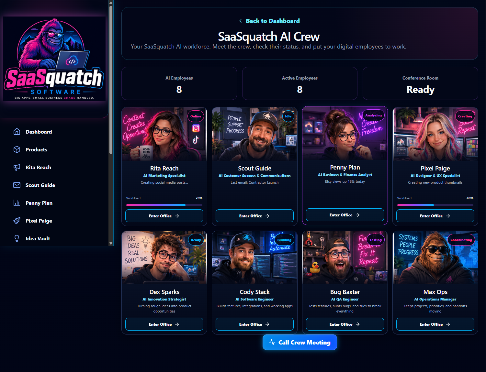
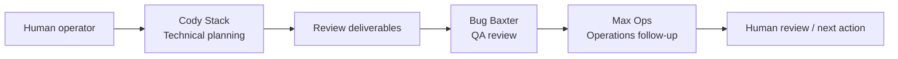
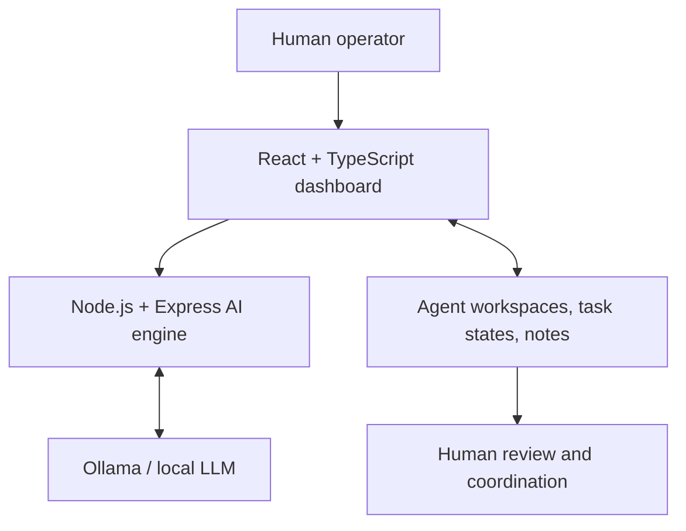

# 🦍 SaaSquatch AI OS

### Multi-Agent AI Workforce & Business Automation Platform

**A custom-built AI workforce dashboard that brings specialized AI employees, task planning, QA reviews, and business workflows into one interface.**

**Public portfolio showcase · Active development · Source code private**

[Developer's GitHub](https://github.com/JCrawford-Devops)

---

## 🖥️ Meet the AI Workforce

*The AI Crew dashboard: specialized employee workspaces, operational statuses, and a shared meeting entry point.*

## What It Does

SaaSquatch AI OS is an independently developed platform that explores practical ways to organize AI-assisted work across software development and business operations. Rather than relying on one general-purpose assistant, the interface gives specialized AI employees distinct roles and workspaces.

- **Manage an AI team:** View specialized agents, their roles, and their individual workspaces.
- **Coordinate assignments:** Create tasks, update statuses, and capture work notes and deliverables.
- **Plan software projects:** Generate AI-assisted technical plans and organize implementation work.
- **Review quality:** Support QA checklists, issue reviews, and engineering-to-QA handoff workflows.
- **Keep a human in control:** Review outputs and use approval-focused workflows for business content.

*Features are evolving. AI-generated plans and workflows are not presented as fully autonomous code execution or production deployment.*

## 🤖 AI Employees

| AI employee | Role |
|---|---|
| **Cody Stack** | Software engineering and implementation planning |
| **Bug Baxter** | QA reviews and testing plans |
| **Dex Sparks** | Innovation and idea development |
| **Rita Reach** | Marketing and social content workflows |
| **Scout Guide** | Customer success and communications |
| **Penny Plan** | Business and finance analysis |
| **Pixel Paige** | Design and UX workflows |
| **Max Ops** | Operations, coordination, and handoffs |

## 🧩 Example Workflow

An operator can assign an engineering-planning task to Cody Stack, review the resulting notes, and route follow-up work to Bug Baxter for a QA review. The workspace also includes controls for sending work onward to Max Ops.

*This diagram illustrates the platform's intended work coordination and available handoff workflow, not an assertion that every step runs without human input.*

## 🛠️ Technology Stack

| Layer | Technologies |
|---|---|
| Frontend | React, TypeScript, Vite, CSS |
| Backend | Node.js, Express, JavaScript, REST APIs |
| Local AI | Ollama and locally hosted language models |
| Development | Git, GitHub, Visual Studio Code |

## 🏗️ High-Level Architecture

## 🗺️ Development Roadmap

- Improve agent-to-agent handoff validation and execution logs.
- Expand QA test planning and measurable results.
- Strengthen error handling, retries, and workflow monitoring.
- Extend role-specific AI employee capabilities.
- Enhance approval controls for generated business content.

## 🔒 Public Showcase / Private Source

This repository is a **portfolio showcase**, not the application source repository. It contains product documentation and approved demonstration imagery. The underlying application code, private configuration, and business-specific information are not published here.

## 👨‍💻 Developed By

**Jesse Crawford**  
Software Engineer · AI Systems Developer · Founder, SaaSquatch Software & Technologies

[github.com/JCrawford-Devops](https://github.com/JCrawford-Devops)
